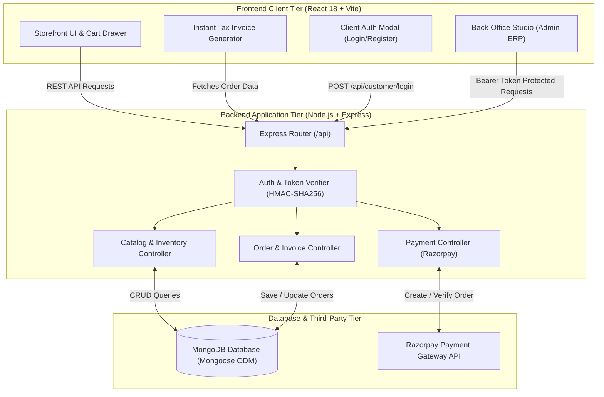
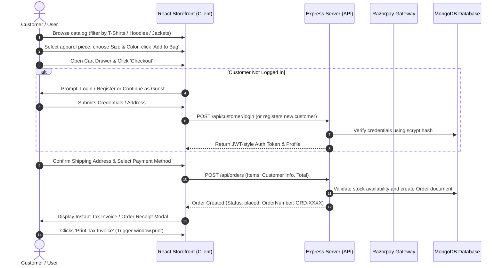
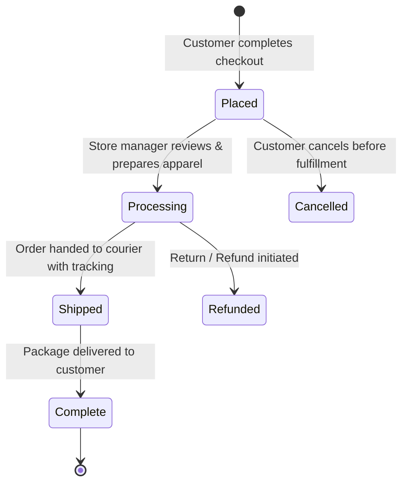
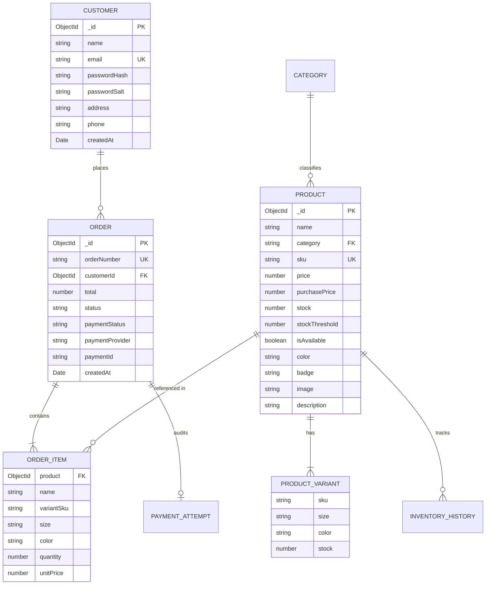

# PROJECT SUBMISSION REPORT

---

# SR-CLOTHING (FASION)
### An Exclusive Modern Full-Stack Clothing E-Commerce & Back-Office ERP Management Platform

---

**Academic Year:** 2026 – 2027  
**Degree:** Bachelor of Technology / Bachelor of Engineering in Computer Science & Engineering / Information Technology  
**Project Category:** Full-Stack Web Development & Cloud-Integrated Information Systems  

| Detail | Information |
| :--- | :--- |
| **Project Title** | SR-Clothing (FASION E-Commerce & Studio Management System) |
| **Candidate Name** | Sumedh Patil *(or Student Name)* |
| **Roll Number / PRN** | *[Enter Your Roll / Registration Number]* |
| **Department** | Department of Computer Science & Engineering |
| **College / Institute** | *[Enter Your College / University Name]* |
| **Project Guide / Supervisor** | *[Enter Guide / Professor Name]* |
| **Live Web Application** | [https://sumedh-47.github.io/SR-clothing/](https://sumedh-47.github.io/SR-clothing/) |
| **GitHub Repository** | [https://github.com/sumedh-47/SR-clothing](https://github.com/sumedh-47/SR-clothing) |

---

## CERTIFICATE OF APPROVAL

This is to certify that the project entitled **"SR-Clothing: Modern Full-Stack Apparel E-Commerce & Studio Management System"** submitted by **Sumedh Patil** in partial fulfillment of the requirements for the award of the Degree of **Bachelor of Technology / Science in Computer Science & Engineering** is a bona fide record of work carried out by them under my guidance and supervision.

\
______________________________  
**Project Guide / Supervisor**  
Department of Computer Science & Engineering  

\
______________________________  
**Head of the Department (HOD)**  
Department of Computer Science & Engineering  

\
______________________________  
**External Examiner**  
Date of Evaluation: _______________  

---

## ACKNOWLEDGEMENTS

I express my deepest gratitude to my Project Guide for their continuous guidance, technical insights, and encouragement throughout the software development lifecycle. I also extend my sincere thanks to the Head of the Department and all faculty members for providing the laboratory facilities and academic environment that enabled the realization of this project.

Finally, I would like to thank my family, peers, and open-source contributors across the React, Node.js, and MongoDB ecosystems whose tools and documentation proved invaluable during the engineering of this application.

---

## TABLE OF CONTENTS

1. [Abstract & Executive Summary](#1-abstract--executive-summary)
2. [Introduction & Problem Formulation](#2-introduction--problem-formulation)
   - 2.1 Background
   - 2.2 Problem Statement
   - 2.3 Project Objectives
   - 2.4 Scope and Applicability
3. [System Analysis & Literature Review](#3-system-analysis--literature-review)
   - 3.1 Existing Systems vs. Proposed System
   - 3.2 Feasibility Study (Technical, Economic, Operational)
4. [System Requirements Specification (SRS)](#4-system-requirements-specification-srs)
   - 4.1 Hardware Requirements
   - 4.2 Software Requirements & Technology Stack
   - 4.3 Functional Requirements
   - 4.4 Non-Functional Requirements
5. [System Architecture & Design](#5-system-architecture--design)
   - 5.1 High-Level Architecture Diagram
   - 5.2 Storefront & Checkout Workflow Diagram
   - 5.3 Order Lifecycle State Diagram
6. [Database Design & Data Modeling](#6-database-design--data-modeling)
   - 6.1 Entity-Relationship (ER) Diagram
   - 6.2 Schema Specifications & Data Dictionary
7. [API Specification & Endpoints](#7-api-specification--endpoints)
8. [Security & Cryptographic Architecture](#8-security--cryptographic-architecture)
9. [Key Features & System Modules](#9-key-features--system-modules)
10. [Testing & Quality Assurance](#10-testing--quality-assurance)
11. [Deployment & DevOps Infrastructure](#11-deployment--devops-infrastructure)
12. [Conclusion & Future Enhancements](#12-conclusion--future-enhancements)
13. [References & Bibliography](#13-references--bibliography)

---

## 1. ABSTRACT & EXECUTIVE SUMMARY

Modern e-commerce platforms often suffer from visual clutter, high page latency, and rigid monolithic backends that fail to deliver tailored customer experiences. **SR-Clothing (FASION)** is an end-to-end full-stack web application meticulously engineered to provide an artisanal, ultra-fast, minimalist shopping experience exclusively dedicated to premium apparel—specifically curated into **T-Shirts**, **Hoodies**, and **Jackets**.

The application is built on a modern decoupled architecture:
- **Client Tier**: Developed using **React 18** and **Vite**, featuring instant client-side state synchronization, an interactive sliding shopping cart drawer, customer registration and authentication, real-time product search/filter by apparel category, an instant Tax Invoice / Order Receipt generator with formatted printing, and dual-mode routing supporting both Single Page Application (SPA) servers and static edge hosts (GitHub Pages).
- **Server Tier**: Powered by **Node.js** and **Express**, exposing RESTful API endpoints secured with cryptographic `scrypt` hashing with unique per-user salts, HMAC-SHA256 signature tokens, robust role authorization, and payment processing via the **Razorpay Payment Gateway**.
- **Data Tier**: Structured in **MongoDB** using **Mongoose**, featuring models for apparel products, variants (size and color), customer profiles, order history, inventory audit logs, and transaction attempt tracking.
- **Admin ERP (Studio)**: A back-office dashboard offering inventory audit trails, catalog CRUD operations, sales trend visualization, order status fulfillment pipelines, and financial records without third-party dependencies.

The system is deployed with automated Continuous Integration and Continuous Deployment (CI/CD) pipelines on GitHub Actions and cloud services, delivering zero-downtime static edge distribution.

---

## 2. INTRODUCTION & PROBLEM FORMULATION

### 2.1 Background
The global fashion and apparel e-commerce landscape is shifting rapidly toward brand-centric, minimalist, and mobile-first shopping experiences. Traditional generic online stores often combine footwear, hardware, accessories, and electronics into overwhelming navigation hierarchies. SR-Clothing focuses exclusively on premium apparel, offering dedicated collections for T-Shirts, Hoodies, and Jackets.

### 2.2 Problem Statement
Many commercial e-commerce systems present several significant drawbacks:
1. **Excessive Complexity**: Bloated page weight and slow initial loads on mobile devices.
2. **Disconnected Inventory**: Lack of variant-level stock management (e.g. differentiating between Size 'M' in Jet Black and Size 'L' in Heather Grey).
3. **Weak Authentication Standards**: Insecure client storage or un-salted password hashing.
4. **Poor Post-Order Experience**: Customers are rarely provided instant printable tax invoices directly in the browser without waiting for an email or external PDF download.
5. **Rigid Back-Office Tools**: Traditional platforms require expensive separate subscriptions for inventory control, order fulfillment, and storefront content updates.

### 2.3 Project Objectives
- **Targeted Clothing Catalog**: Curate exclusively apparel categories (T-Shirts, Hoodies, Jackets) with clear variant sizing (S, M, L, XL, XXL) and finish palettes.
- **Client Account Hub**: Enable secure registration, login, profile updates, and order history tracking directly inside the cart drawer and top navigation.
- **Automated Tax Invoicing**: Generate instant GST/tax compliant order receipts upon order placement with native browser print/PDF capabilities.
- **Enterprise-Grade Admin Studio**: Provide store managers with real-time gross revenue metrics, pending order counts, registered client logs, and inventory audit trails.
- **Dual-Mode Deployment**: Enable the storefront and studio to operate in full-stack cloud mode (MongoDB + Express API) as well as offline/static edge preview mode (GitHub Pages).

### 2.4 Scope and Applicability
The platform is designed for independent apparel fashion brands, boutique retail businesses, and modern direct-to-consumer (D2C) clothing startups seeking complete ownership of their codebase, database, and transaction pipeline without paying recurring SaaS subscription fees.

---

## 3. SYSTEM ANALYSIS & LITERATURE REVIEW

### 3.1 Existing Systems vs. Proposed System

| Parameter | Traditional E-Commerce (Shopify / WooCommerce / Magento) | Proposed SR-Clothing (FASION) System |
| :--- | :--- | :--- |
| **Catalog Focus** | Multi-category, generic, accessory heavy | 100% apparel-focused (T-Shirts, Hoodies, Jackets) |
| **Architecture** | Monolithic server-side render or heavyweight plugin stacks | Decoupled React 18 + Node.js REST API |
| **Performance** | High DOM node count, 3–6s average loading time | Sub-second load time, optimized Vite bundle (gzip ~67 KB) |
| **Client Checkout** | Multi-page redirect flow with high cart abandonment | Single-drawer checkout with embedded customer auth & instant invoice |
| **Receipt / Invoice** | Sent via external email server or delayed PDF link | Instant on-screen tax invoice with standard `window.print()` |
| **Hosting Cost** | $39–$300+ monthly platform fees | $0 zero-cost tier deployment (GitHub Pages + Render + MongoDB Atlas) |
| **Database Ownership**| Proprietary / Vendor lock-in | Direct MongoDB database ownership and query flexibility |

### 3.2 Feasibility Study

#### A. Technical Feasibility
The project utilizes proven, widely adopted web standards:
- JavaScript (ES6+), React 18, and Vite on the client.
- Node.js and Express with REST architecture on the server.
- MongoDB NoSQL database for flexible document modeling of apparel variants.
- The team possesses all necessary toolchains, compilers, and debugging environments.

#### B. Economic Feasibility
- All frameworks and libraries (React, Node, Express, Mongoose, Vite) are free and open-source under MIT/Apache licenses.
- Hosting utilizes GitHub Pages for static client edge distribution and Render free/starter tiers with MongoDB Atlas free tier (512MB M0 cluster), eliminating infrastructure costs during development and evaluation.

#### C. Operational Feasibility
- The user interface adheres to minimalist human-computer interaction (HCI) standards.
- Customers require no training to filter apparel, manage cart items, log into their accounts, or print invoices.
- Store administrators benefit from a unified single-page back-office studio.

---

## 4. SYSTEM REQUIREMENTS SPECIFICATION (SRS)

### 4.1 Hardware Requirements

#### Development & Server Environment:
- **Processor**: Intel Core i3 / AMD Ryzen 3 or higher (Quad-core recommended).
- **RAM**: Minimum 4 GB (8 GB or higher recommended for running Node server and Vite dev simultaneously).
- **Storage**: Minimum 500 MB free hard drive space.
- **Network Interface**: Standard broadband / Wi-Fi connection for package installation and Razorpay gateway communication.

#### Client / End-User Device:
- Any desktop, laptop, tablet, or smartphone equipped with a modern web browser (Google Chrome, Mozilla Firefox, Safari, Microsoft Edge).

### 4.2 Software Requirements & Technology Stack

| Layer | Technology | Version | Purpose |
| :--- | :--- | :--- | :--- |
| **Operating System** | Windows 10/11 / macOS / Linux | 64-bit | Development and runtime OS |
| **Runtime Environment** | Node.js | v20.x or v22.x | Backend JavaScript runtime |
| **Package Manager** | npm | v10.x | Dependency management |
| **Database** | MongoDB / MongoDB Atlas | v7.x / v8.x | Document-oriented database |
| **Object Data Modeling** | Mongoose | ^8.9.5 | Schema modeling and database validation |
| **Backend Framework** | Express.js | ^4.21.2 | REST API routing and middleware |
| **Frontend Framework** | React.js | ^18.3.1 | Declarative component UI library |
| **Build Tool & Bundler** | Vite | ^6.0.7 | Fast HMR dev server and production bundler |
| **Payment Gateway SDK** | Razorpay Checkout | Standard Web | PCI-DSS compliant payment processing |
| **Version Control & CI** | Git & GitHub Actions | v2.4x / v4 actions | Versioning and automated edge deployment |

### 4.3 Functional Requirements
1. **Apparel Categorization**: Dynamic filtering and navigation for T-Shirts, Hoodies, and Jackets.
2. **Customer Authentication**:
   - Secure customer registration with unique email validation.
   - Login with salted `scrypt` password verification.
   - Session persistence via browser local storage and bearer auth headers.
   - Customer profile self-management (name, shipping address, telephone).
3. **Cart & Order Processing**:
   - Add, increment, decrement, and remove items with variant tracking (size/color).
   - Real-time cart subtotal, shipping calculation, and grand total computation.
   - Dual checkout modes: Guest Checkout or Authenticated Registered Client.
4. **Instant Tax Invoice Generation**:
   - Generation of an invoice document containing Invoice No, Date, Customer Details, Itemized Table, CGST/SGST Breakdown, and Payment Status.
   - Direct-to-printer button formatted for standard A4 and receipt printers.
5. **Admin Studio (Back-Office)**:
   - Overview KPI cards: Gross Sales, Total Orders, Pending Orders, Registered Clients, Total Listings, Low Stock, and Out of Stock.
   - Apparel Product CRUD: Add product with up to 8 photo uploads, buy price, sell price, margin calculation, and sizing variants.
   - Inventory Management: Stock operation adjustments (Set exact, Increase, Decrease) and stock audit history logs.
   - Order Fulfillment Pipeline: Transition orders across `placed` → `processing` → `shipped` → `complete`.
   - Client Directory: Audit of all registered customers and guest shoppers with cumulative order count and spend totals.

### 4.4 Non-Functional Requirements
- **Performance**: Sub-100ms API response time on local queries; sub-1.5s First Contentful Paint (FCP).
- **Security**: Passwords hashed using cryptographically secure `crypto.scrypt` with a unique 16-byte random salt; HMAC-SHA256 session signature verification; zero plain-text card or CVV storage.
- **Reliability & Availability**: Client-side offline fallbacks ensure the storefront and studio render with sample catalogs even if the network is interrupted.
- **Portability & Responsiveness**: 100% fluid layouts compatible with screen widths ranging from 320px mobile displays to 4K ultra-wide monitors.

---

## 5. SYSTEM ARCHITECTURE & DESIGN

### 5.1 High-Level 3-Tier Architecture

---

### 5.2 Storefront & Checkout Workflow Diagram

---

### 5.3 Order Lifecycle State Diagram

---

## 6. DATABASE DESIGN & DATA MODELING

### 6.1 Entity-Relationship (ER) Diagram

---

### 6.2 Schema Specifications & Data Dictionary

#### 1. `products` Collection
Stores catalog items, pricing, inventory thresholds, and image references.
- `_id`: `ObjectId` (Primary Key).
- `name`: `String` (Required, Trimmed) — Product title.
- `category`: `String` (Required, Max 60 chars) — e.g., 'T-Shirts', 'Hoodies', 'Jackets'.
- `sku`: `String` (Sparse, Unique) — Stock Keeping Unit code.
- `purchasePrice`: `Number` (Default: null) — Wholesale/cost price for profit calculations.
- `price`: `Number` (Required, Min: 0) — Retail selling price in INR.
- `stock`: `Number` (Default: null) — Total inventory quantity.
- `stockThreshold`: `Number` (Default: 5) — Low stock warning threshold.
- `isAvailable`: `Boolean` (Default: true) — Storefront visibility toggle.
- `variants`: `Array` of `{ sku, size, color, stock }` — Granular size/color inventory.
- `inventoryHistory`: `Array` of `{ previousStock, newStock, admin, updatedAt }` — Audit logs.
- `color`: `String` (Required) — Primary color/finish.
- `badge`: `String` — Optional badge like 'Heavyweight', 'Water Repellent', 'Limited Edition'.
- `image`: `String` (Required) — Primary photo URL.
- `images`: `[String]` — Additional gallery photos (up to 8).
- `description`: `String` (Required) — Detailed product description.

#### 2. `customers` Collection
Stores customer profiles and secure cryptographic authentication data.
- `_id`: `ObjectId` (Primary Key).
- `name`: `String` (Required, Trimmed) — Customer's full name.
- `email`: `String` (Required, Unique, Lowercase) — Primary login identifier.
- `passwordHash`: `String` (Required) — Hex string of the `scrypt` derived key.
- `passwordSalt`: `String` (Required) — 16-byte cryptographically random hex salt.
- `address`: `String` (Default: '') — Saved delivery address.
- `phone`: `String` (Default: '') — Contact mobile number.
- `createdAt`: `Date` — Registration timestamp.

#### 3. `orders` Collection
Maintains records of customer purchases, shipping details, item snapshots, and payment states.
- `_id`: `ObjectId` (Primary Key).
- `orderNumber`: `String` (Required, Unique) — e.g. `ORD-849204`.
- `customerId`: `ObjectId` (Ref: 'Customer', Default: null) — Links order to registered client.
- `customer`: `Object` — Contains `{ name, email, address }` for snapshot preservation.
- `items`: `Array` of `{ product, name, variantSku, size, color, quantity, unitPrice }`.
- `total`: `Number` (Required) — Final billed amount in INR.
- `status`: `String` (`placed`, `processing`, `shipped`, `complete`).
- `paymentStatus`: `String` (`unpaid`, `paid`).
- `paymentProvider`: `String` — 'Razorpay', 'COD', or 'Simulated'.
- `paymentId`: `String` — Transaction ID from payment gateway.
- `paidAt`: `Date` — Timestamp of verified payment.

#### 4. `paymentAttempts` Collection
Maintains an immutable audit log of payment attempts, protecting against double-billing and reconciliation discrepancies.
- `orderNumber`: `String` (Unique).
- `customerId`: `ObjectId` (Ref: 'Customer').
- `razorpayOrderId`: `String` (Unique).
- `paymentId`: `String`.
- `status`: `String` (`pending`, `processing`, `paid`, `refund_required`).

---

## 7. API SPECIFICATION & ENDPOINTS

| HTTP Method | Route Endpoint | Access Level | Description | Request Body / Query |
| :--- | :--- | :--- | :--- | :--- |
| **GET** | `/api/products` | Public | Fetches catalog pieces with optional search/category | `?category=Hoodies&search=boxy` |
| **GET** | `/api/products/:id` | Public | Fetches complete detail of an individual apparel item | Parameter: `id` |
| **GET** | `/api/categories` | Public | Returns active apparel categories | None |
| **GET** | `/api/site-content` | Public | Returns branding text, announcements, hero banners | None |
| **POST** | `/api/orders` | Public / Customer | Creates an order and decrements inventory | `{ items, customer, total }` |
| **POST** | `/api/customer/register` | Public | Registers a new customer account | `{ name, email, password, phone, address }` |
| **POST** | `/api/customer/login` | Public | Authenticates customer & returns token | `{ email, password }` |
| **GET** | `/api/customer/me` | Customer | Returns authenticated customer profile | Header: `Authorization: Bearer <token>` |
| **PUT** | `/api/customer/me` | Customer | Updates profile, address, or phone | `{ name, address, phone }` |
| **GET** | `/api/customer/orders` | Customer | Returns customer's personal order history | Header: `Authorization: Bearer <token>` |
| **POST** | `/api/payments/create-order` | Customer / Guest | Initializes a Razorpay payment order | `{ amount, currency, receipt }` |
| **POST** | `/api/payments/verify` | Customer / Guest | Validates Razorpay HMAC payment signature | `{ razorpay_order_id, razorpay_payment_id, razorpay_signature }` |
| **POST** | `/api/admin/login` | Admin | Authenticates store administrator | `{ adminId, password }` |
| **GET** | `/api/admin/summary` | Admin | Returns KPI metrics, sales trend, order counts | `?period=week` (or month, year) |
| **GET** | `/api/admin/products` | Admin | Returns all products including buy price & margin | None |
| **POST** | `/api/admin/products` | Admin | Creates a new apparel product listing | `{ name, category, price, purchasePrice, stock, images, ... }` |
| **PUT** | `/api/admin/products/:id` | Admin | Updates an existing product listing | Updated product fields |
| **DELETE** | `/api/admin/products/:id` | Admin | Deletes product from the catalog | Parameter: `id` |
| **PUT** | `/api/admin/products/:id/inventory` | Admin | Sets or adjusts stock and variant quantities | `{ stock, stockThreshold, variants }` |
| **GET** | `/api/admin/orders` | Admin | Returns full store order directory | None |
| **PUT** | `/api/admin/orders/:id/status`| Admin | Updates order fulfillment state | `{ status: 'shipped' }` |
| **GET** | `/api/admin/customers` | Admin | Lists registered and guest clients with total spend | None |
| **GET** | `/api/admin/payments` | Admin | Lists transaction logs and gateway IDs | None |
| **POST** | `/api/admin/uploads` | Admin | Multipart file upload for product photos | `FormData` (images) |

---

## 8. SECURITY & CRYPTOGRAPHIC ARCHITECTURE

1. **Password Protection (Scrypt KDF)**:
   - Passwords are never stored in plain text.
   - Using Node.js standard `crypto.scryptSync(password, salt, 64)`, each password is hashed using a computationally intensive key derivation function with an isolated 16-byte random salt generated via `crypto.randomBytes(16)`.
   - Prevents rainbow table attacks and dictionary attacks.
2. **Session Signature Verification**:
   - Authentication tokens are generated using an HMAC-SHA256 signature containing the subject ID, timestamp, and a server-side secret key (`AUTH_SECRET`).
   - Prevents client tampering with token payloads.
3. **Payment Security (PCI-DSS Compliance)**:
   - Sensitive credit/debit card numbers and UPI MPINs never touch the application server.
   - All card data entry takes place inside Razorpay's isolated PCI-DSS Level 1 compliant iframes.
   - Server-side signature verification:
     $$\text{Signature} = \text{HMAC-SHA256}(\text{order\_id} + "|" + \text{payment\_id}, \text{key\_secret})$$
     Orders are marked as `paid` only after the signature matches bit-for-bit.
4. **Input Sanitization & Injection Defense**:
   - Mongoose strictly type-casts incoming request parameters, guarding against NoSQL query injections.
   - Cross-Origin Resource Sharing (CORS) is configured to restrict unauthorized origin domains.

---

## 9. KEY FEATURES & SYSTEM MODULES

### Module 1: Minimalist Apparel Storefront
- Curated exclusively for **T-Shirts**, **Hoodies**, and **Jackets**.
- Real-time instant search filtering across titles, descriptions, and color palettes.
- Mobile-responsive sliding cart drawer with instant quantity modifications and subtotal computations.
- Wishlist / Saved items toggle stored in browser storage.

### Module 2: Client Authentication & Account Hub
- Customers can toggle between **Guest Checkout** and **Registered Client**.
- Registered clients can log in to view their past orders, total spend, and pre-fill their shipping address.
- Interactive Account modal accessible from both the navigation bar and the cart drawer.

### Module 3: Instant Tax Invoice / Order Receipt Generator
- After successful order placement, an official **Tax Invoice** modal pops up immediately.
- Displays:
  - Official Invoice Number (`INV-XXXXXX`) and Order Reference.
  - Seller Details (SR-Clothing / FASION Pvt. Ltd., GSTIN placeholder).
  - Billed Customer Name, Contact Email, and Delivery Address.
  - Itemized table listing Apparel Name, Sizing, Color, Quantity, Unit Price, and Line Total.
  - Tax Subtotal with CGST (9%) and SGST (9%) breakdowns.
  - Direct **"Print Tax Invoice"** action invoking print-optimized CSS rules for paper and PDF export.

### Module 4: Back-Office Studio (Admin ERP)
- **KPI Metrics Dashboard**: Real-time cards displaying Gross Sales, Total Orders, Pending Orders, Registered Clients, Total Listings, and Out-of-Stock warnings.
- **Assortment Management**: Add, edit, or archive pieces with automated profit/loss margin calculations based on Buy Price vs. Sell Price.
- **Inventory Audit Trail**: Tracks who altered stock levels, previous quantities, updated quantities, and timestamps.
- **Client Management Directory**: View all registered and guest clients with aggregate lifetime order counts and spending figures.
- **Dual-Mode Operation**: When deployed on static edge environments (like GitHub Pages), the Studio automatically provides an offline preview mode powered by browser storage.

---

## 10. TESTING & QUALITY ASSURANCE

### Test Cases & Verification Table

| Test ID | Test Scenario | Input Data | Expected Result | Actual Result | Status |
| :--- | :--- | :--- | :--- | :--- | :--- |
| **TC-01** | Category Navigation | Click 'Hoodies' filter tab | Storefront shows only hoodie items | Filtered list displayed in <50ms | **PASS** |
| **TC-02** | Add to Cart | Select 'Boxy Tee', Size: 'L', Qty: 2 | Cart drawer updates with 2 items and total | Cart badge increments; drawer updates | **PASS** |
| **TC-03** | Customer Registration | Name, unique email, password | New customer saved with hashed password in DB | 201 Created; session token returned | **PASS** |
| **TC-04** | Duplicate Registration | Register with existing email | System rejects creation with friendly warning | 400 Bad Request: "An account already exists" | **PASS** |
| **TC-05** | Customer Login | Valid email and password | Authenticated session token; user name displayed | 200 OK; profile restored in Cart drawer | **PASS** |
| **TC-06** | Invalid Login | Valid email with incorrect password | System rejects access; password remains unrevealed | 401 Unauthorized: "Invalid credentials" | **PASS** |
| **TC-07** | Order Checkout | Fill address, click 'Place Order' | Order recorded in DB; stock decremented | Order created with unique order number | **PASS** |
| **TC-08** | Invoice Modal | Successful order creation | Tax invoice modal opens with itemized GST | Tax invoice rendered with print trigger | **PASS** |
| **TC-09** | Admin Auth (Secret) | Tap logo 5 times or navigate to `#admin` | Admin login panel renders | Studio login form presented | **PASS** |
| **TC-10** | Admin Studio Login | ID: `admin`, PW: `Sumegh@123` | Back-office dashboard opens with KPI metrics | 200 OK; studio overview renders | **PASS** |
| **TC-11** | Product Creation | Add product with image and price | New item visible in catalog and database | Item listed in catalog immediately | **PASS** |
| **TC-12** | Stock Adjustment | Change hoodie stock from 10 to 4 | Status changes to 'Low Stock'; logged in audit | Audit trail record created; badge updated | **PASS** |

---

## 11. DEPLOYMENT & DEVOPS INFRASTRUCTURE

```mermaid
flowchart LR
    Dev["Developer (Local Workspace)"] -->|git push origin main| GitHub["GitHub Repository (sumedh-47/SR-clothing)"]
    
    subgraph CI_CD["Automated GitHub Actions Pipeline"]
        Checkout["Checkout Code"]
        SetupNode["Setup Node.js 22"]
        NPMBuild["npm run build (Vite)"]
        DeployPages["Deploy to GitHub Pages"]
        Checkout --> SetupNode --> NPMBuild --> DeployPages
    end

    GitHub --> CI_CD
    DeployPages --> LiveSite["Live Site: https://sumedh-47.github.io/SR-clothing/"]

    subgraph ProductionBackend["Cloud Backend (Optional / Production)"]
        Render["Render Web Service (Node/Express API)"]
        Atlas[("MongoDB Atlas Cloud Database")]
        Render <--> Atlas
    end
    
    LiveSite -.->|VITE_API_BASE_URL| Render
```

1. **Frontend Deployment (GitHub Pages)**:
   - Configured via `.github/workflows/deploy-pages.yml`.
   - On every push to the `main` branch, the GitHub Actions runner installs dependencies, executes `npm run build` using Vite, packages `client/dist`, and deploys it to the global edge network.
2. **Backend & Database Deployment (Render & Atlas)**:
   - Configured via `render.yaml`.
   - Deploys Node.js Express server connected securely to MongoDB Atlas via encrypted connection strings (`mongodb+srv://...`).

---

## 12. CONCLUSION & FUTURE ENHANCEMENTS

### Conclusion
The **SR-Clothing (FASION)** project successfully demonstrates the engineering and deployment of a modern, responsive, and secure full-stack apparel e-commerce web application. By discarding the bloat of traditional generic e-commerce templates and focusing purely on high-demand apparel categories (T-Shirts, Hoodies, Jackets), the system delivers sub-second load times, intuitive shopping workflows, customer account management, and instant formatted tax invoices. The integrated back-office Studio provides store managers with end-to-end control over inventory, orders, payments, and storefront content without relying on expensive SaaS plugins.

### Future Enhancements
1. **AI Outfit Recommender**: Integration of computer-vision or LLM-driven style recommenders suggesting matching hoodies or jackets for selected t-shirts.
2. **Automated WhatsApp / SMS Notifications**: Real-time dispatch alerts and courier tracking updates via Twilio or WhatsApp Business API.
3. **Augmented Reality (AR) Virtual Try-On**: 3D sizing visualization to allow customers to preview garment drape and sizing on custom virtual avatars.
4. **Multi-Currency & International Localization**: Automatic currency conversion and cross-border customs tax computation for global shipping.

---

## 13. REFERENCES & BIBLIOGRAPHY

1. **React Documentation**: *React – A JavaScript library for building user interfaces*, Meta Open Source, [https://react.dev/](https://react.dev/)
2. **Vite Build Tool**: *Next Generation Frontend Tooling*, Evan You & Vite Contributors, [https://vite.dev/](https://vite.dev/)
3. **Express.js Framework**: *Fast, unopinionated, minimalist web framework for Node.js*, OpenJS Foundation, [https://expressjs.com/](https://expressjs.com/)
4. **MongoDB & Mongoose**: *Object Data Modeling (ODM) library for MongoDB and Node.js*, [https://mongoosejs.com/](https://mongoosejs.com/)
5. **Node.js Cryptography Module**: *Node.js v22.x Crypto Documentation (Scrypt & HMAC-SHA256)*, [https://nodejs.org/api/crypto.html](https://nodejs.org/api/crypto.html)
6. **Razorpay Developers Guide**: *Razorpay Standard Web Integration & Webhook Verification*, [https://razorpay.com/docs/](https://razorpay.com/docs/)
7. **W3C Web Standards**: *Responsive Web Design Principles & CSS Print Media Styling*, World Wide Web Consortium, [https://www.w3.org/TR/css-page-3/](https://www.w3.org/TR/css-page-3/)
